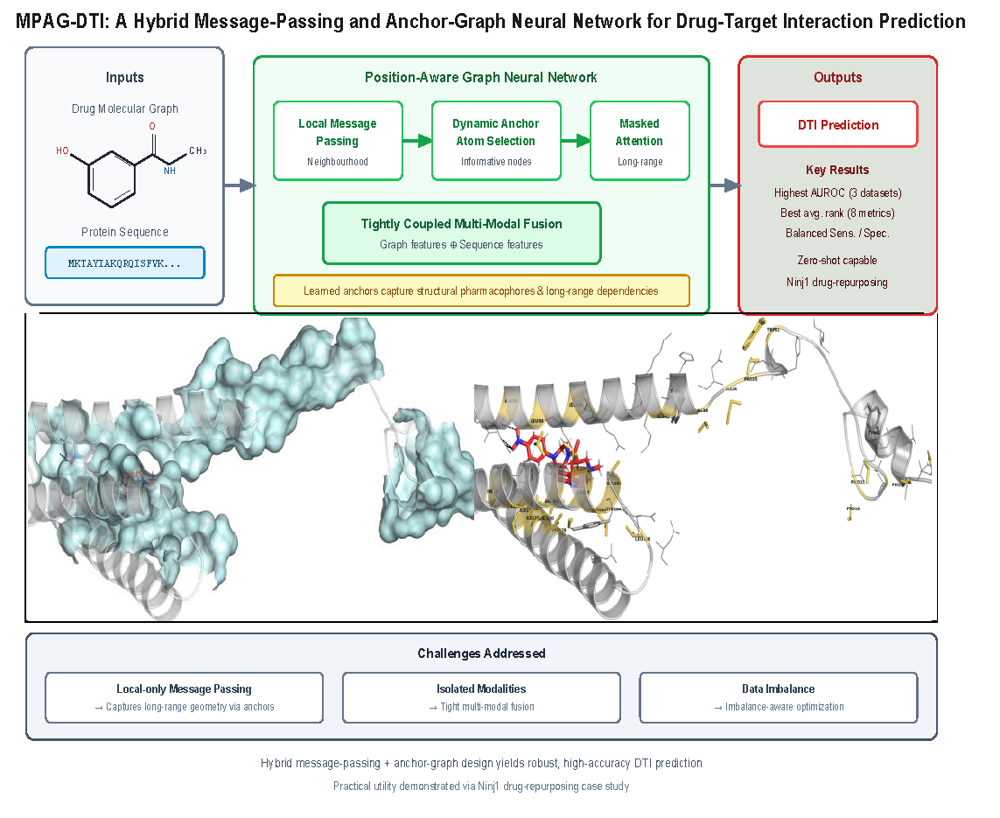

# MPAG-DTI: A Hybrid Message-Passing and Anchor-Graph Neural Network for Drug-Target Interaction Prediction

[](https://www.python.org/)
[](https://pytorch.org/)
[](LICENSE)

<p align="center">
  
</p>

<p align="center"><b>Figure 1.</b> Overview of the MPAG-DTI architecture.<br>
The model combines message-passing neural networks (MPNN) and an anchor-graph neural network for drug molecules and sequence based CNN based proteins, followed by a hybrid interaction module designed to handle severe class imbalance.</p>
download the release it contains all training datasets, trained model and code. Follow the following steps: https://github.com/khushnood/mpagdti/releases/tag/mpagdti

---

## ✨ Highlights

- **Hybrid Graph Architecture**: Message-Passing Neural Network (MPNN-GCN) + Anchor-Graph Neural Network for for drugs and CNN for protein sequences
- **Class-Imbalance Aware**: Weighted BCE  + early stopping on AUPRC
- **Strong Generalization**: Pretrained models on DAVIS, BindingDB_Kd and KIBA
- **Drug Repurposing Ready**: Rank any chemical library against a novel protein sequence in minutes


---

## 📦 Installation


### 1. Create environment

```bash
conda create -n mpagdti python=3.10 -y
conda activate mpagdti

# Core deep-learning stack
torch==2.8.0+cu128
torch-geometric==2.7.0
torch_sparse==0.6.18+pt28cu128
torch_scatter==2.1.2+pt28cu128
torch_cluster==1.6.3+pt28cu128
torch_spline_conv==1.2.2+pt28cu128

# Graph libraries
dgl==0.9.0
dgllife==0.3.2

# Scientific / data stack
numpy==1.26.4
pandas==1.3.5
scipy==1.10.1
scikit-learn==1.6.1

# Utilities
tqdm==4.67.3
loguru==0.7.2

# Domain-specific
PyTDC==0.4.1
rdkit==2023.3.2
networkx==3.4.2

# Train from scratch
# DAVIS
python main.py --dataset DAVIS --split_type random --epochs 200 --seed 1

# BindingDB_Kd
python main.py --dataset BindingDB_Kd --split_type random --epochs 200 --seed 1

# KIBA
python main.py --dataset KIBA --split_type random --epochs 200 --seed 1

#Evaluate a pretrained checkpoint
Bash
python main.py --dataset DAVIS --pretrained_model_path  ../results_MPAGDTI/random/output/pretrained_model_local/modelMPAGDTI_DAVIS_epoch200.pt --seed 1

python main.py --dataset BindingDB_Kd --pretrained_model_path  ../results_MPAGDTI/random/output/pretrained_model_local/modelMPAGDTI_BindingDB_Kd_epoch200.pt --seed 1

python main.py --dataset KIBA --pretrained_model_path  ../results_MPAGDTI/random/output/pretrained_model_local/modelMPAGDTI_KIBA_epoch200.pt --seed 1

#Drug Repurposing (novel / known target)
Provide any protein amino-acid sequence and a pretrained model; the script ranks the entire chemical library of the training dataset.
Bash
# KIBA model → NINJ1
python main_repurposing.py --model_path ../results_MPAGDTI/random/output/pretrained_model_local/modelMPAGDTI_KIBA_epoch200.pt --protein MDSGTEEYELNGGLPPGTPGSPDASPARWGWRHGPINVNHYASKKSAAESMLDIALLMANASQLKAVVEQGPSFAFYVPLVVLISISLVLQIGVGVLLIFLVKYDLNNPAKHAKLDFLNNLATGLVFIIVVVNIFITAFGVQKPLMDMAPQQ --dataset KIBA  --top_n 50 --output ../results/repurposing_KIBA_NINJ1.csv


# BindingDB model → NINJ1
python main_repurposing.py --model_path ../results_MPAGDTI/random/output/pretrained_model_local/modelMPAGDTI_BindingDB_Kd_epoch200.pt --protein MDSGTEEYELNGGLPPGTPGSPDASPARWGWRHGPINVNHYASKKSAAESMLDIALLMANASQLKAVVEQGPSFAFYVPLVVLISISLVLQIGVGVLLIFLVKYDLNNPAKHAKLDFLNNLATGLVFIIVVVNIFITAFGVQKPLMDMAPQQ --dataset BindingDB_Kd --top_n 50 --output ../results/repurposing_BindingDB_NINJ1.csv

# DAVIS model → NINJ1
python main_repurposing.py --model_path ../results_MPAGDTI/random/output/pretrained_model_local/modelMPAGDTI_DAVIS_epoch200.pt --protein MDSGTEEYELNGGLPPGTPGSPDASPARWGWRHGPINVNHYASKKSAAESMLDIALLMANASQLKAVVEQGPSFAFYVPLVVLISISLVLQIGVGVLLIFLVKYDLNNPAKHAKLDFLNNLATGLVFIIVVVNIFITAFGVQKPLMDMAPQQ --dataset DAVIS  --top_n 50 --output ../results/repurposing_DAVIS_NINJ1.csv

# Attribution

This work utilizes code from [DeepPurpose](https://github.com/kexinhuang12345/DeepPurpose).

> Huang, K., Fu, T., Glass, L. M., Zitnik, M., Wang, C., & Xiao, C. (2021).
> DeepPurpose: a deep learning library for drug–target interaction prediction.
> *Bioinformatics*, 36(22-23), 5545–5547.
